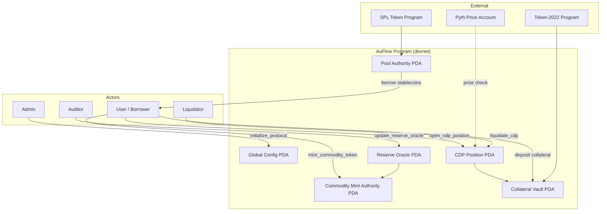

# AuFlow Protocol — Capstone Project

**AuFlow** is a Solana lending protocol built with **Anchor**. Users deposit **Token-2022 commodity collateral** (backed by audited vault reserves), borrow **stablecoins** from a shared liquidity pool, and face **liquidation** when collateral value falls below a safety threshold. Prices come from **Pyth legacy price feeds** (simulated in tests via a small devnet helper program).

This repository is the **Turbin3 capstone** deliverable: on-chain program, devnet deployment, integration tests, and documentation for demo and review.

---

## Capstone checklist

| Requirement | Status |
|-------------|--------|
| Program deployed to **devnet** | Yes |
| **Tests** exercising the full flow | Yes (local Bankrun + devnet RPC) |
| **Devnet Program ID** in this README | See below |
| **Architecture** documented | See [Architecture](#architecture) |
| **Screenshot** of passing tests | Add `docs/test-passing.png` (see [Testing](#testing)) |

---

## Devnet deployment

| Program | Program ID | Explorer |
|---------|------------|----------|
| **AuFlow** (main) | `4oAhHznC9vvn8bgEHE1qahGx3a4etjsWCTyP6EXDpbuZ` | [View on Solana Explorer (devnet)](https://explorer.solana.com/address/4oAhHznC9vvn8bgEHE1qahGx3a4etjsWCTyP6EXDpbuZ?cluster=devnet) |
| **Pyth mock** (test helper) | `FQe9htidwUatxPXqwXEe1g1943AmjCjHnSxgNe9zVd2C` | [View on Solana Explorer (devnet)](https://explorer.solana.com/address/FQe9htidwUatxPXqwXEe1g1943AmjCjHnSxgNe9zVd2C?cluster=devnet) |

The **Pyth mock** program exists only so devnet tests can update a legacy-format price account (Solana does not allow arbitrary account data writes without a program). Production integrations would use live Pyth push feeds on mainnet/devnet.

---

## What the protocol does (demo narrative)

1. **Initialize** — Admin sets global risk parameters (max LTV, liquidation threshold, bonus) and designates an **auditor** for reserve attestations.
2. **Proof of reserve** — Auditor publishes total vault weight and a Merkle root per metal type.
3. **Mint commodity tokens** — Users mint **Token-2022** units up to the on-chain reserve cap.
4. **Open CDP** — User locks commodity in a vault PDA, borrows stablecoins from the pool if **collateral value × LTV** supports the debt (Pyth price).
5. **Liquidate** — Anyone repays unhealthy debt and receives collateral plus a **liquidation bonus** when value drops below the threshold.

Default risk parameters (basis points, 10_000 = 100%):

- Max LTV: **75%**
- Liquidation threshold: **85%**
- Liquidation bonus: **5%**

---

## Architecture

### High-level flow



### Program Derived Addresses (PDAs)

| Seed(s) | Account |
|---------|---------|
| `["config"]` | Global protocol config |
| `["reserve", metal_type]` | Reserve attestation per metal |
| `["mint", metal_type]` | Commodity mint authority |
| `["cdp", owner, metal_type]` | CDP position |
| `["vault", cdp]` | Collateral token vault |
| `["pool"]` | Stablecoin pool authority |

Metal types: `0` = AuGold, `1` = AuSilver (constants in program).

### Instructions (requirements map)

| ID | Instruction | Purpose |
|----|-------------|---------|
| REQ01 | `initialize_protocol` | Create config PDA, set admin & auditor |
| REQ02 | `mint_commodity_token` | Mint Token-2022 against reserve cap |
| REQ03 | `update_reserve_oracle` | Auditor-signed reserve update |
| REQ04 | `open_cdp_position` | Deposit collateral + borrow (atomic) |
| REQ05 | `liquidate_cdp` | Liquidate undercollateralized positions |

---

## Repository layout

```
auflow-protocol/
├── README.md                 ← This file (capstone overview)
├── docs/
│   ├── test-passing.png      ← You add: screenshot of passing tests
│   └── test-results.txt      ← Optional: saved CLI output
└── anchor/
    ├── Anchor.toml           ← Program IDs (localnet + devnet)
    ├── programs/
    │   ├── auflow/           ← Main protocol
    │   └── pyth_mock/        ← Devnet test helper for Pyth layout
    ├── tests/
    │   ├── auflow.ts         ← Full flow (Bankrun, fast, no RPC)
    │   ├── auflow.devnet.ts  ← Full flow against devnet
    │   └── helpers.ts        ← Shared test utilities
    └── target/deploy/        ← Built `.so` and keypairs (after build)
```

---

## Prerequisites

Install these before building or demoing:

1. **Rust** (stable) — [rustup.rs](https://rustup.rs)
2. **Solana CLI** (v1.18+) — [Solana install docs](https://solana.com/docs/intro/installation)
3. **Anchor CLI** (0.30.x or 0.31.x aligned with `package.json`) — [Anchor install](https://www.anchor-lang.com/docs/installation)
4. **Node.js** (18+) and **Yarn**
5. A Solana keypair at `~/.config/solana/id.json` with **devnet SOL** for deploy and devnet tests

**Configure Solana for devnet:**

```bash
solana config set --url devnet
solana balance
solana airdrop 2   # repeat if needed; devnet rate limits apply
```

---

## Step-by-step: local setup

### 1. Clone and enter the Anchor workspace

```bash
cd auflow-protocol/anchor
```

### 2. Install JavaScript dependencies

```bash
yarn install
```

### 3. Build the programs

```bash
anchor build
```

This compiles `auflow` and `pyth_mock`, generates the IDL under `target/idl/`, and TypeScript types under `target/types/`.

### 4. Run fast integration tests (recommended for demos)

Uses **Bankrun** (in-process VM) with a mock Pyth account — no devnet SOL required.

```bash
yarn test
```

Expected output:

```text
auflow (bankrun)
  ✔ REQ01–REQ05: protocol integration

1 passing
```

**For your capstone screenshot:** run the command above (and optionally devnet tests below), capture the terminal, and save as:

`docs/test-passing.png`


*(Replace this image once you add your screenshot.)*

---

## Step-by-step: deploy to devnet

From `auflow-protocol/anchor`, with your wallet funded on devnet:

### 1. Deploy AuFlow

```bash
anchor deploy --provider.cluster devnet --program-name auflow
```

### 2. Deploy Pyth mock (required for devnet integration tests)

```bash
anchor deploy --provider.cluster devnet --program-name pyth_mock
```

Program IDs must match `Anchor.toml` and `declare_id!` in each `lib.rs`. If you generate new keypairs, update those files and rebuild before deploying.

---

## Step-by-step: devnet integration tests

These tests send real transactions to `https://api.devnet.solana.com` against the deployed program IDs.

**Requirements:**

- Wallet with enough devnet SOL (~0.5 SOL recommended for a full run; rent for the Pyth mock feed account is paid by the wallet).
- On **first** successful run, `initialize_protocol` uses your wallet as **admin** and **auditor**. Later runs must use the **same wallet**, or you will need a fresh config PDA (new deployment / new cluster state).

```bash
cd auflow-protocol/anchor
export ANCHOR_PROVIDER_URL=https://api.devnet.solana.com
export ANCHOR_WALLET=~/.config/solana/id.json
yarn test:devnet
```

Expected:

```text
auflow (devnet)
  ✔ REQ01–REQ05: protocol integration on devnet

1 passing
```

---

## Demo script (5–10 minutes)

Use this order when presenting to instructors or peers:

1. **Context** — Explain RWA commodity collateral, CDP borrowing, and oracle-based risk (Pyth).
2. **Architecture** — Walk through the mermaid diagram: config → reserve → mint → CDP → liquidation.
3. **Code tour** (optional, 2 min) — `programs/auflow/src/lib.rs` (five instructions) and `utils/oracle.rs` (Pyth validation).
4. **Live tests** — Run `yarn test` in the terminal; show **1 passing** and REQ01–REQ05 coverage.
5. **Devnet** — Open Explorer links for `4oAhHznC9vvn8bgEHE1qahGx3a4etjsWCTyP6EXDpbuZ`; optionally run `yarn test:devnet` if SOL is available.
6. **Q&A** — PDAs, atomic `open_cdp_position`, liquidation bonus, auditor role.

---

## Technology stack

| Layer | Choice |
|-------|--------|
| Framework | Anchor 0.31.x |
| Commodity token | SPL Token-2022 |
| Stablecoin | SPL Token (6 decimals, micro-USD semantics in math) |
| Oracle | Pyth legacy account (`pyth-sdk-solana`) |
| Local tests | Mocha + Chai + `anchor-bankrun` / `solana-bankrun` |
| Devnet tests | Mocha + `@coral-xyz/anchor` provider |

---

## Troubleshooting

| Issue | What to do |
|-------|------------|
| `anchor build` / IDL errors | Ensure Anchor CLI and `anchor-lang` versions match; run `anchor build` again after `cargo clean` if needed. |
| Devnet airdrop failed | Wait and retry, or use a faucet; reduce parallel transfers. |
| Devnet test: auditor mismatch | Use the same wallet that called `initialize_protocol`, or deploy to a fresh program ID and re-init. |
| Devnet test: insufficient lamports for `init_feed` | Fund wallet (`solana airdrop 2`); Pyth mock feed rent is paid by the wallet. |
| Bankrun `Could not find <pubkey>` | Run `yarn test` only via `tests/auflow.ts`; ensure `anchor build` completed. |

---

## Security note

This is an **educational capstone**, not audited production software. The `pyth_mock` program is for **testing only**. Do not use these patterns on mainnet without professional review.